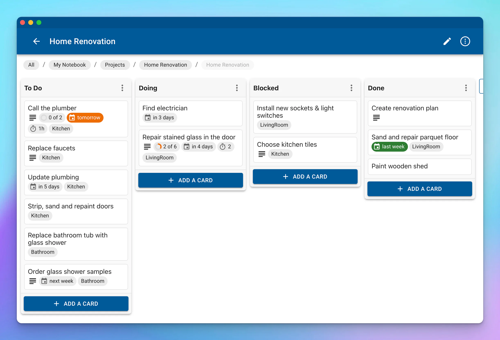
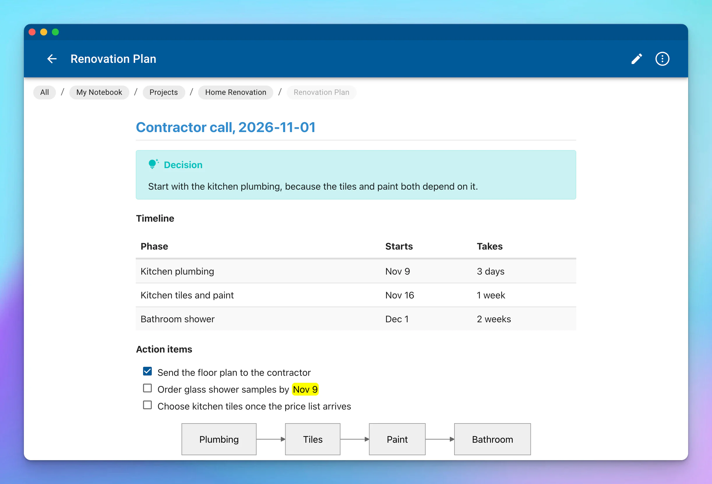

In this post, we will learn how to let Claude, Codex, Cursor and other AI agents manage your notes using our free and open-source **agent skill for [NotesHub](/)**.

Let's start with why you may want this. Your AI agent can plan a trip, summarize a meeting or break a project into tasks, but then the result stays in the chat, and you are the one who copies it into your notes and updates the board. With the skill installed, you just ask:

> "Add *call the plumber* to my renovation board for Monday, tag it Kitchen"
> "Move everything finished this week to Done"
> "Draw our sync architecture as a whiteboard in Projects/NotesHub"
> "Append today's meeting notes to the Q4 planning note"



If you are on board, let's dive in.

## Why an agent skill

NotesHub keeps your notes as plain files in a place you control: a Git repository, iCloud Drive or a folder on your device. So an agent that can edit files and use Git could, in theory, already work with your notebook. The problem is that a file can look fine and still be wrong for the app:

- **Kanban boards** — NotesHub rewrites a `.kanban.md` file on every change and drops anything it doesn't recognize, so an intro sentence or a `*` bullet disappears on the next save.
- **Whiteboards** — a `.excalidraw.svg` file is a picture with the real scene compressed inside. If an agent edits the picture, the app simply ignores the change.
- **Notes** — a single newline is a visible line break in NotesHub, so text hard-wrapped at 80 columns looks broken.

This is where an agent skill comes in. A skill is just a folder with a `SKILL.md` file containing instructions for an AI agent, plus optional scripts. The [format](https://agentskills.io) was created by Anthropic and released as an open standard, and it is supported by a growing list of agents.

Our skill is not integrated into the app. It is completely independent: it runs in your agent and works on the same repositories and folders that NotesHub reads. It just teaches the agent the format NotesHub expects and ships small scripts for the risky parts, so nothing gets lost the next time the app saves.

## What it can do

- **Markdown notes** — create notes, append to them and find things in them. The agent writes NotesHub's Markdown flavor, including [callouts and Mermaid diagrams](/blog/archive/2023/10/noteshub-30), highlights, math, links between notes and attachments.
- **Kanban boards** — add, move and update cards with due dates, estimates, tags and [subtasks](/blog/archive/2024/4/noteshub-33), or create new boards.
- **Excalidraw whiteboards** — draw new [whiteboards](/blog/archive/2024/4/noteshub-33) from a simple description and edit existing ones. Arrows stay attached to their shapes, so you can keep editing the result by hand in NotesHub.
- **Git sync** — for Git notebooks, the skill makes a quick text-only checkout, then commits, rebases onto the latest version and pushes. For iCloud Drive and local folders, the agent works on the files in place.

## Prerequisites

- _Python 3.8+ and Git:_ only if your agent runs on your computer, while the GitHub CLI (`gh`) and Node.js are optional. In the Claude apps, including on your phone, the skill runs in Claude's own sandbox, so there is nothing to install
- _Access to your notebook:_ a Git repository your agent can clone and push to, or a local or iCloud folder it can access. An agent on your computer uses your existing Git credentials, while a cloud agent, such as Claude on your phone, usually needs you to connect the repository to the session first

## Install the NotesHub skill

The skill lives in our public GitHub repository [NotesHubApp/noteshub-skills](https://github.com/NotesHubApp/noteshub-skills) under the MIT license. The steps depend on your agent.

### Claude (web, desktop and mobile)

1. Turn on code execution in _Settings_, since skills need it.
2. Go to _Customize -> Plugins_, then choose _Add -> Add marketplace -> Add from a repository_.
3. Enter `NotesHubApp/noteshub-skills` and add the _NotesHub_ plugin.

The plugin is attached to your account, so you can also use it from your phone and in Claude Code sessions signed in with the same account. Please note that plugins in the Claude apps require a paid plan.

### Claude Code

```sh
claude plugin marketplace add NotesHubApp/noteshub-skills
claude plugin install noteshub@noteshub-skills
```

To keep it up to date, run `/plugin`, open the _Marketplaces_ tab and turn on auto-update for `noteshub-skills`.

### Codex, Cursor, GitHub Copilot, Gemini CLI and other agents

The [skills CLI](https://github.com/vercel-labs/skills) installs the skill for the agents you choose. The `-g` flag makes it available in all of your projects instead of just the current one:

```sh
npx skills add NotesHubApp/noteshub-skills -g
```

To update it later, run `npx skills update`.

If you prefer to do it manually, you can [download the repository as a ZIP](https://github.com/NotesHubApp/noteshub-skills/archive/refs/heads/main.zip) and copy `skills/noteshub` into your agent's skills folder.

## Tell your agent where your notebooks are

Out of the box, the skill knows *how* to edit NotesHub files, but not *where* your things are. If you have one notebook and name it in the prompt, that's enough. But with several notebooks, you don't want to explain every time that "my daily board" means `Daily Work.kanban.md` in your QuickNotes repository.

Our solution is a second, tiny skill that belongs only to you. We call ours `my-notebooks`, and it made the biggest difference to how we use the NotesHub skill: "add a task" now just works, from any session and any project. Here is how the pieces fit together:


### Create your personal skill

Here is a shortened version of the skill we use every day. Save it as `SKILL.md` in a folder named `my-notebooks`, then replace the notebooks and rules with your own:

```markdown
---
name: my-notebooks
description: "Where my NotesHub notebooks live and my defaults: daily board, second brain, recipes, family trips. Use with the noteshub skill for any request to add, find or change my notes, tasks or boards."
---

# My NotesHub notebooks

This skill says **where** things go. The **noteshub** skill says **how**: file formats and scripts. Load both.

## Notebooks

All are GitHub repos synced by NotesHub on branch `main`.

| Notebook | Repo | What's in it |
|---|---|---|
| QuickNotes | `your-name/QuickNotes` | `Daily Work.kanban.md` (daily task board), `Project Ideas.kanban.md`, quick notes |
| SecondBrain | `your-name/SecondBrain` | Second brain in PARA: `Projects/`, `Areas/`, `Resources/`, `Archives/` |
| Cookbook | `your-name/Cookbook` | Recipes by category folder |
| Family | `your-name/Family` | Shared family notebook: `Travel/Trips/YYYY-MM Place.md`, packing lists |

Every repo has an `AGENTS.md` at the root with its detailed conventions. Read it right after opening the notebook and follow it.

## Routing

- "daily board", "add a task", "what's on my plate", "mark X done" -> QuickNotes `Daily Work.kanban.md`
- "idea for an app or project" -> QuickNotes `Project Ideas.kanban.md`, list `Concept`
- Lasting knowledge, how-tos, project notes -> SecondBrain (PARA)
- Recipes -> Cookbook. Trips and packing lists -> Family.
- If a request could fit two notebooks, ask, naming the two candidates.

## Defaults

- My time zone is <your time zone>: resolve "today", "tomorrow" and "Friday" there and write dates as YYYY-MM-DD.
- Reply in a sentence or two with what changed and where.
- The Family notebook holds private records. Read only what the task needs and never copy those details into other notebooks or summaries unless I ask.
```

The most important parts are the description, which is the only thing the agent reads before deciding to load the skill, so use the words you would actually say, and the routing section, which maps your own phrases to exact files.

Now install it:

- _Claude apps:_ create a ZIP of the folder with `zip -r my-notebooks.zip my-notebooks/`, upload it under _Customize -> Skills_ on the web or in the desktop app, and turn it on
- _Claude Code:_ copy the folder to `~/.claude/skills/my-notebooks/`
- _Other agents:_ run `npx skills add ./my-notebooks -g`

This skill is your private map, so keep it out of public repositories. And if you would rather not write it by hand, let your agent do it:

> "Look at my NotesHub notebooks *your-name/QuickNotes* and *your-name/SecondBrain*, ask me a few questions about how I use them, and write a my-notebooks skill for me."

### Add AGENTS.md to your notebook

The personal skill is a map across notebooks. For rules inside a single notebook, add an `AGENTS.md` (or `CLAUDE.md`) file to its root. The NotesHub skill reads it before changing anything in that notebook, and because it lives with your notes, it also works for your collaborators and their agents. Here is a short example, and you can find a [full template](https://github.com/NotesHubApp/noteshub-skills/blob/main/skills/noteshub/assets/AGENTS.template.md) in the repository:

```markdown
# Notebook guide for AI agents

## What this notebook is
My personal second brain (PARA). Synced by NotesHub with GitHub.

## Where things go
- `Projects/<Project>/`: active projects, boards live next to their notes
- `Resources/`: reference material by topic
- `Archives/`: finished projects

## Boards
- "Add a task" with no board named -> `Projects/Daily.kanban.md`, list `Today`
- Tags in use: #Home #Work #Errand

## Don't
- Don't delete notes; move them to `Archives/`
```

If you don't have this file yet, the agent follows the folder and file name patterns it finds, and it can offer to create one for you.

## Examples

All of the results below come from running the skill on a demo notebook and opening it in NotesHub.

### Capture a task

> "Add *call the plumber* to my renovation board for Monday, tag it Kitchen. It should take about an hour. I need to get a quote and book a visit this week."

The agent opens the notebook, works out the date, adds the card, checks the file and pushes a commit like `Kanban: add 'Call the plumber' to To Do`. This is what it writes to the board, and you can see the result in the first screenshot of this post:

```markdown
## To Do
- Call the plumber ~1h #Kitchen 2026-11-02  
  - [ ] Get a quote
  - [ ] Book a visit this week
```

NotesHub picks it up on its next sync, which runs when the app starts and then about once a minute.

### Turn a messy call into a note

> "Here are my notes from the call with the contractor. Add a clean summary to my Renovation Plan note and put the action items on the board."

The agent appends a new section to the note using NotesHub's own Markdown, without touching the text around it, and adds the action items to the board as new cards.



### Draw a diagram

> "Draw how the NotesHub skill works as a whiteboard in my notebook."

The whiteboard earlier in this post was made this way. It is a real `.excalidraw.svg` file: GitHub shows it as a picture, and NotesHub opens it as a whiteboard you can keep editing.

### More prompts to try

Once your personal skill is in place, these work without naming any files or repositories:

- "What's on my plate this week?"
- "Move everything I finished this week to Done"
- "Which of my cards are overdue?"
- "Plan a long weekend in Kyoto, save it to my trips and add the bookings to my daily board"
- "Save this recipe to my cookbook"
- "Rename the Doing list to In Progress on my renovation board"
- "Add a payment service to the architecture whiteboard and connect it to the API"

## Is it safe?

Letting an AI agent edit your notes is a fair thing to worry about, so we made the skill careful by design:

- **Every change is a Git commit** — in a Git notebook, you can see what the agent did and revert it. The skill never force-pushes or rewrites history.
- **It doesn't guess** — a vague card reference fails with the candidates listed, instead of moving the wrong card.
- **It protects what's already there** — if a board contains lines NotesHub would drop, the script won't write to it until the problem is fixed or you agree to lose them.
- **We are not in the middle** — the skill has no server and no account. It runs in your agent and works directly with your Git host or your folder, so your notes never pass through our servers.

> **Please note that whatever the agent reads is sent to your AI provider under its terms, so only give the agent access to the notebooks you are comfortable sharing. Also, a skill runs with your agent's permissions, so it's worth reading before you install it. Ours is plain Markdown and Python, all [on GitHub](https://github.com/NotesHubApp/noteshub-skills).**

## Common questions

- **Does it only work with Claude?** No. It follows the open Agent Skills format, so it works with Claude, Claude Code, Codex, Cursor, GitHub Copilot, Gemini CLI and other agents that support skills and can run scripts.
- **Is it free?** Yes. The skill is free and MIT-licensed, and the web version of NotesHub is free too. Your AI tool has its own pricing, though.
- **Is this an MCP server?** No, and it doesn't need one. MCP gives an agent access to an outside service, while a [skill teaches it how to do something](https://www.claude.com/blog/skills-explained). Your notes are already plain files that an agent can reach with Git, so there is no server to run and no extra login.
- **Does it work without GitHub?** Yes. It works with any Git server, including a [self-hosted one](/blog/archive/2024/1/self-hosting-your-notes-in-git), as well as iCloud Drive and local folders. The only requirement is that the agent can reach the notebook, so a cloud agent can't edit a folder on your computer.
- **What happens if the app and the agent change the same file?** The agent starts from the latest version and rebases its commit before pushing. On a real conflict, it stops without pushing and redoes the edit on the fresh files.
- **Can I use this to build an AI second brain?** Yes, that's how we use it ourselves. NotesHub handles capture, reading and editing on your phone and desktop, and your agent can file, summarize and reorganize things in the same Markdown files.

That's it! Ask your agent to add your first task, and while it's working, it's the right time to drink tea. If you like the skill, a star on [GitHub](https://github.com/NotesHubApp/noteshub-skills) is always appreciated, and we would love to hear about your best prompts on [Reddit](https://www.reddit.com/r/noteshub).
