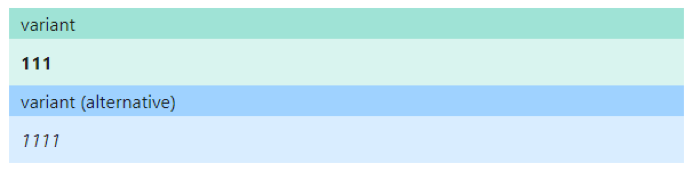

_First published in June 2021 on my personal blog._

## Introduction

Hello my friend. I may assume that some of you also write blog posts. Then the next question for you, how do you author them, what tool/platform do you use? WordPress, Blogger, Medium, anything else?
Since I'm software developer and not always try to find easy and straightforward path, I developed my own simple blogging system where all the blog posts are stored in Git repository as markdown files. During the build process they will be compiled into HTML files to easy serve from CDN. However, in this approach there is one single problem, it may not be the most pleasant way to change or create blog post from VS Code or GitHub website.
Luckily, my recently developed tool **[NotesHub](https://noteshub.app)** solved this puzzle, and this post is meant to open the curtain behind my new project.

## Birth of the idea

I started thinking about the idea of my new side project in late Fall 2020. The main driver was the dislike of some core principals of OneNote, at that moment the primary note-taking app for my personal needs.
I like everything to be in order, to match styles and it's not an easy task when you deal with such apps like OneNote. When you copy-paste a text from the browser it will preserve all the styles including font colors, font sizes, etc. As a result, you will end-up when all your notes look different. You may see echoing of style preserving also when you look at your notes on mobile device, and see horizontal scroll to appear, where I would only expect vertical scrolling. The second annoying thing for me is that it's too easy to change something, I had several times when I changed the notes by accident and then realized it too late. Don't put me wrong, OneNote is amazing application. It has a lot of strengths like supporting real-time collaboration, writing with stylus and many more, however those benefits are not really important for me, and disadvantages appeared to overweight everything else.

I started looking for alternatives. Since I'm already familiar with Markdown, it become the first think to come into my mind as format for notes. Markdown solves the problem with styles since it has limited formatting options. For instance, you can't change font face, color, size just with syntax itself, that is exactly what I needed.
By searching in App Store, I found GitJournal application which kind of what I was looking for. When I showed it for my wife, she said that it's not good enough to pay for it. My response was: "Ok, challenge accepted, I'll write my own app". That event become the starting point for NotesHub project.

## Implementation

Since I'm huge fan of [PWA](https://en.wikipedia.org/wiki/Progressive_web_application) and have experience with creating such application I had no doubt what technology to use. The idea is simple and not new - create web app which uses Git for notes storage and Markdown for notes representation. In October 30, 2020 I made my first commit.
Initially I planned to use only GitHub API for notes synchronization, but then I quickly realized all of the limitations. I would not be able to fully implement offline use-cases like editing and creating notes without network connectivity. With some searching I found https://isomorphic-git.org open-source project which I could use as Git client in the browser and that will enable range of possibilities compare with just using GitHub API:

* Much faster Notebooks cloning.
* Full offline support.
* Ability to perform [three-way merge](https://en.wikipedia.org/wiki/Merge_(version_control)) of notes.
* Faster sync operation.

I don't want to write detailed development process but would like to highlight some challenges along the road.

### Editor and preview scroll sync
That sound simple, when you scroll editor then preview should scroll to match the content and vice versa.
It turned-out is not easy to implement and it took solid two weeks to get satisfactory result. In JavaScript you can't get the position of visible text from text area. To over-come this limitation, I decided to build in real-time shadow HTML tree with elements for each source line. Finally, I can get positions for those shadow elements and map them to elements from preview panel. In fact, I got smoother scrolling experience then in VS Code or Azure DevOps which I'm really proud.

### Bullet-proof Git sync
Almost before my first public release I found a serious bug which postponed release to almost a month. The problem appeared in some rare cases when you make changes in notes and close the app. After restarting the application, local Git repository may go to bad state when only re-cloning will help and as result your local edits will get lost, pretty serious, ha? After intensive debugging I found the root cause, the default file-system provider [lightning-fs](https://github.com/isomorphic-git/lightning-fs) for isomorphic-git uses the hybrid model when part of the data is stored in memory and is persisted to IndexedDB with a debounce of 500ms. If you terminate the application in the middle, you will be screwed. I did not find a better way for this problem then writing my own file-system layer for Git. It turned out not as fast as lightning-fs but much more robust for any interference during pull/push operations.

### Graceful merge conflict resolutions
Most of the note-taking apps don't take sync conflicts seriously. Often you can see "last one wins" or two separate copies of conflicting notes as a resolution. Since I'm using Git here, I decided to take advantage of that. Git is designed to work with text files and has built-in features to resolve merge conflicts. Perfect, except the fact that standard Git merge markers `<<<<<<<`, `=======` and `>>>>>>>` are not really compatible with Markdown syntax and as result you will get ugly rendered note where user will not get any idea what is going on. After some brainstorming, I decided to implement my own merge markers and beautifully render them for the user. I ended-up with the following syntax:

```
::: variant
edited from mobile
:::
::: alt-variant
edited from desktop
:::
````
Rendered result:



> If during note sync different lines were updated, they will be merged automatically without any alternative variants.

In the last day before going to vacation in Cancun, I made the final commit to finalize MVP version of the project and ended the 6-month journey from the idea to first stable release. Project was finally available to public.

## Competitors comparison

Here I would like to highlight and compare some notable competitors and availability of key features which I defined for myself.

| | Markdown support | Git support | Cross-platform | Web app | Merge conflicts<br>auto-resolution |
|--|--|--|--|--|--|
| [**NotesHub**](https://noteshub.app) | **yes** | **yes** | **yes** | **yes** | **yes** |
| [OneNote](https://onenote.com/) | no | no | yes | no | yes |
| [Evernote](https://evernote.com) | no | no | yes | no | no<br>(duplicate files) |
| [GitJournal](https://gitjournal.io) | yes | yes | no | no | no<br>(last one wins) |
| [Joplin](https://joplinapp.org) | yes | no | yes | no | no<br>(duplicate files) |
| [StackEdit](https://stackedit.io/) | yes | yes | yes | yes | no<br>(last one wins) |
| [Notion](https://www.notion.so) | yes | no | yes | no | no<br>(last one wins) |
| [Notable](https://notable.app) | yes | no | no | no | no |


## The road ahead
As for any new product I'm seeking for public support. This will determine the future of the project and availability of new features. In my head I see a lot of ways for improvements and here there is list of some of them:

* Quick notes - ability to create new notes for predefined notebook/section from the application main screen.
* Draft notes - will help to restore data after application crash or sudden close when you have unsaved notes.
* Syntax highlighting for code blocks.
* Support of [Mermaid](https://mermaid-js.github.io/mermaid) diagrams.
* Support of [KaTeX](https://katex.org) for math expressions.
* Notes search capabilities.
* Printing and exporting notes.

If you have any feature suggestions please send the request in the application.

## At the end
If you have read from the beginning to this point you maybe the wondering how NotesHub helps me with writing blog posts which I mentioned in introduction. Even that my project is simply note-taking app, I managed to connect my blogging system to it without any modification to the app itself. I created a separate Git repository for all blog posts which I can edit from NotesHub. The repository is linked as Git sub-module to the blogging project. GitHub action periodically updates submodule which will trigger blog to rebuild and publish updated version. This blog post is the first product of my app. Going forward I plan to use NotesHub exclusively for authoring all my personal notes and blog posts. Happy writing everyone!

## Learn more
- [Interview with Website Planet](https://www.websiteplanet.com/blog/noteshub-interview)
